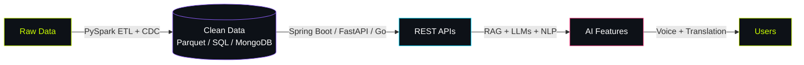

<div align="center">


<br/>

<a href="https://debansh12.github.io/"></a>
<a href="https://www.linkedin.com/in/debansh-panda-86645327a/"></a>
<a href="mailto:pandadebansh@gmail.com"></a>
<a href="https://hcltechcareercompassai-dcb89vtyuckxsytaaudugx.streamlit.app/"></a>

<br/>


</div>

<br/>

## `> whoami`

```yaml
developer:
  name:        Debansh Panda
  role:        Software Engineer | AI Builder
  education:   B.Tech, Computer Science & Engineering   # SOA ITER, Bhubaneswar
  graduated:   August 2026
  base:        Odisha, India

stack_focus:
  - Applied AI & LLM apps (RAG, voice, multilingual)
  - Backend engineering (Java/Spring Boot, FastAPI, Go)
  - Data engineering (PySpark, ETL, CDC)
  - NLP for low-resource languages

principles:
  - Build useful things
  - Validate with evidence
  - Automate the repetitive
  - Learn by shipping

seeking: [Software Engineering, Backend Development, Applied AI/ML, Data Engineering]
```

I build systems that take messy real-world input, validate it, connect services, and turn it into something useful: from a multilingual AI career coach to an Odia-language NER model, PySpark pipelines, and production-style REST APIs.

<br/>

## `> impact --metrics`

<div align="center">


<br/>


</div>

<br/>

## `> ls projects/`

<table>
<tr>
<td width="50%" valign="top">

### 🧭 CareerCompass AI
<sub>`GENERATIVE AI` · HCLTech Odisha 2026 Sovereign AI Hackathon</sub>

LLM-powered career guidance for engineering students, with Gemini prompts grounded by **RAG** to match roles across **16 role families and 6 branches**.

- Sarvam AI voice + translation pipeline: **11 languages, Hinglish, 29 voices**
- Document processing and interactive Plotly visualizations

`Python` `Streamlit` `Gemini API` `Sarvam AI` `RAG` `Plotly` `PyPDF` `python-docx`

**[→ Launch live demo](https://hcltechcareercompassai-dcb89vtyuckxsytaaudugx.streamlit.app/)**

</td>
<td width="50%" valign="top">

### 🌾 Odia Named Entity Recognition
<sub>`NLP` · Low-resource language · Agriculture</sub>

Domain-aware NER for agricultural queries in Odia, built on **XLM-RoBERTa** fine-tuned over a **17K+ BIO-tagged dataset**.

- **90.8% F1** and **97.3% accuracy**
- Knowledge-base mapping layer resolves entities into structured data

`Python` `XLM-RoBERTa` `Hugging Face` `PyTorch` `TensorFlow` `Scikit-learn` `Pandas` `Kaggle`

</td>
</tr>
<tr>
<td width="50%" valign="top">

### 🛡️ TraceGuard
<sub>`BACKEND` · Exception tracking & AI-assisted incident analysis</sub>

Java 21 / Spring Boot engine that groups recurring exceptions using **SHA-256 fingerprints** and PostgreSQL, targeting a 50%+ reduction in duplicate alerts.

- Live incident updates via **SSE**
- Gemini-powered diagnosis and patch suggestions
- Dead-letter webhook replay, tested with JUnit 5 + MockMvc

`Java 21` `Spring Boot 3.3` `JPA/Hibernate` `PostgreSQL` `React` `Tailwind` `Docker`

</td>
<td width="50%" valign="top">

### 👥 Employee Attendance & Analytics API
<sub>`BACKEND` · FastAPI + MongoDB</sub>

**12 FastAPI REST endpoints** for attendance tracking and analytics, powered by MongoDB aggregation pipelines with Pydantic validation.

- Fixed **21 starter defects**
- Tested unique indexes on **120K documents** with **68 pytest tests**

`Python` `FastAPI` `MongoDB` `PyMongo` `Pydantic` `pytest` `mongomock`

</td>
</tr>
<tr>
<td width="50%" valign="top">

### 🔄 Retail Orders ETL Pipeline
<sub>`DATA ENGINEERING` · Data quality · CDC</sub>

PySpark pipeline that cleans **20,200 orders**: quarantines **419 invalid rows**, removes **197 duplicates**, and writes **~19,600 clean orders** to partitioned Parquet.

- CDC logic over **1,421 customer records**
- Logging, Cron scheduling, run locking, **10 pytest tests**

`PySpark` `SQL` `Parquet` `Pandas` `Bash` `Cron` `pytest`

</td>
<td width="50%" valign="top">

### 💸 GoPay Transaction Validation API
<sub>`BACKEND` · Go</sub>

REST endpoint that validates incoming transaction requests with four checks (**sender, receiver, amount, currency**) and returns predictable HTTP status codes and JSON errors.

<sub>*A validation prototype, not a payment processor.*</sub>

`Go` `net/http` `REST` `JSON` `Error Handling`

</td>
</tr>
<tr>
<td width="50%" valign="top">

### 📚 Library Management REST API
<sub>`BACKEND` · Java + Spring Boot</sub>

Layered REST API with **5 CRUD endpoints**, centralized error handling via `@RestControllerAdvice`, and Postman-validated behaviour across **25+ records**.

`Java 17` `Spring Boot` `Spring Data JPA` `Hibernate` `H2` `Maven` `Postman`

</td>
<td width="50%" valign="top" align="center">

<br/><br/>

### 🔭 More on GitHub

<a href="https://github.com/DEBANSH12?tab=repositories"></a>

</td>
</tr>
</table>

<br/>

## `> cat stack.json`

<div align="center">

**Languages**


**Backend & Frontend**


**AI / ML**


**Data & Databases**


**Cloud, DevOps & Tools**


</div>

<details open>
<summary><b>Full skill matrix</b></summary>
<br/>

| Domain | Technologies |
|:--|:--|
| **Languages** | Python · Java · SQL · Bash · JavaScript · TypeScript · PowerShell · C++ |
| **Backend & APIs** | Spring Boot · Spring MVC · Spring Data JPA · Hibernate · FastAPI · Django/Flask · REST APIs · Spring RestClient · SSE · Pydantic |
| **Frontend** | React · Next.js · Tailwind CSS · HTML5 · CSS3 |
| **AI / ML** | LLM Applications · RAG · Prompt Engineering · LangChain · MCP · Gemini API · OpenAI API · Hugging Face · STT · TTS · PyTorch · TensorFlow · Scikit-learn · Pandas · NumPy |
| **AI dev tools** | GitHub Copilot · Claude Code · Codex |
| **Data Engineering** | PySpark · ETL Pipelines · CDC · Parquet · Batch Processing · Data Validation |
| **Databases** | PostgreSQL · MySQL · MongoDB · Oracle · Schema Design · Indexing |
| **Cloud & DevOps** | AWS (EC2, S3, IAM, RDS) · Azure Fundamentals · Docker · Kubernetes · Terraform · Jenkins CI/CD · Linux · Git/GitHub |
| **Testing** | JUnit 5 · MockMvc · pytest · Postman · Selenium · Unit / API / Regression Testing |
| **CS Fundamentals** | Data Structures & Algorithms · OOP · Operating Systems · Computer Networks · SDLC · Agile |

</details>

<br/>

## `> pipeline --what-i-build`



<br/>

## `> git log --experience`

<table>
<tr>
<td>

**Content Curator Intern** · [BetterLearning.ai](https://betterlearning.ai) *(Modal Technologies Pvt. Ltd.)*
<sub>Remote · June – July 2026</sub>

- Reviewed and fixed errors in **15+ technical learning modules every sprint** within a small Agile team
- Corrected mistakes in technical datasets using reviewer feedback, contributing to a **50% error reduction**

`Technical Validation` `Data Accuracy` `Quality Assurance` `Agile`

</td>
</tr>
</table>

<br/>

## `> achievements --unlocked`

<div align="center">


</div>

- 🏆 Ranked **top 10% of 1,000+ candidates** in SOA ITER's DevOps Internals Program
- 🚀 Shortlisted among **200+ candidates across Odisha** for the HCLTech 2026 GET Sovereign AI Hackathon
- 🎯 Secured **Grade A** in the MyAnatomy National Competence & Employability Test

<br/>

## `> certifications --verify`

| Certification | Issuer | Year |
|:--|:--|:-:|
| 🤖 Agentic AI Foundations Associate | Oracle | 2026 |
| 🐍 Python Basic | HackerRank | 2026 |
| ☕ Java Basic | HackerRank | 2024 |
| ⚙️ DevOps Internals | SOA University / ITER | 2025 |

<br/>

## `> github --telemetry`

<div align="center">


</div>

<sub>Stats are rendered by third-party services and may be cached or briefly unavailable. Language stats reflect repository code, not overall proficiency.</sub>

<br/>

## `> cat roadmap.txt`

```text
[01] Deepening backend engineering and API design
[02] Shipping practical AI and LLM-powered applications
[03] Improving data pipeline reliability and data quality
[04] Expanding cloud, testing, and deployment experience
[05] Turning projects into maintainable, well-documented software
```

<br/>

<div align="center">

## ⚡ LET'S BUILD SOMETHING THAT MATTERS

*AI-powered ideas. Reliable backends. Data that makes sense.*

<a href="https://debansh12.github.io/"></a>
<a href="https://www.linkedin.com/in/debansh-panda-86645327a/"></a>
<a href="mailto:pandadebansh@gmail.com"></a>


<sub>DESIGNED IN THE TERMINAL · BUILT ONE COMMIT AT A TIME</sub>

</div>
